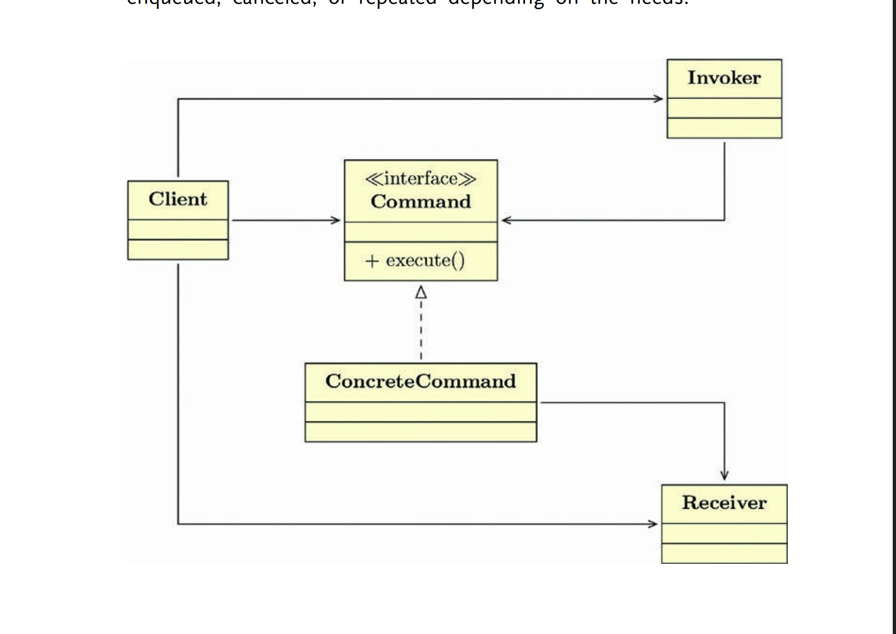
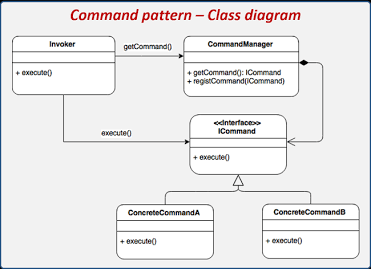
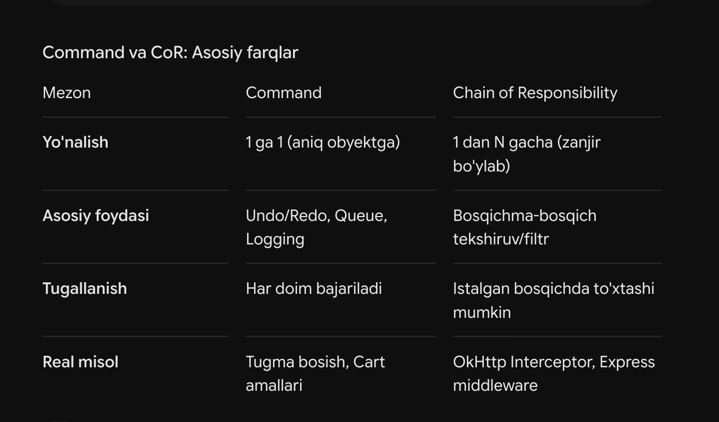

Command design pattern — bu biror amal yoki so'rovni alohida obyektga aylantirish (encapsulate qilish) patterni. Uning asosiy maqsadi — amalni chaqiruvchi (masalan, UI tugma) bilan uni bajaruvchi (biznes logika) o'rtasidagi bog'liqlikni uzishdir

### Structure

The Command design pattern is composed of four main components—the the the Invoker, and the These elements
collaborate in order to execute the requests, which are in the
form of object-encapsulated commands and can be executed,
enqueued, canceled, or repeated depending on the needs

**Qachon ishlatmaslik kerak?** Agar tugma bosilganda shunchaki bitta oddiy funksiya chaqirish kerak bo'lsa va Undo/Queue kabi talablar bo'lmasa, Command pattern ortiqcha klasslar (boilerplate) qo'shadi xolos.

