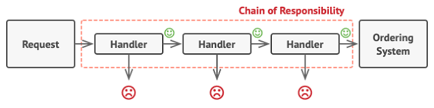
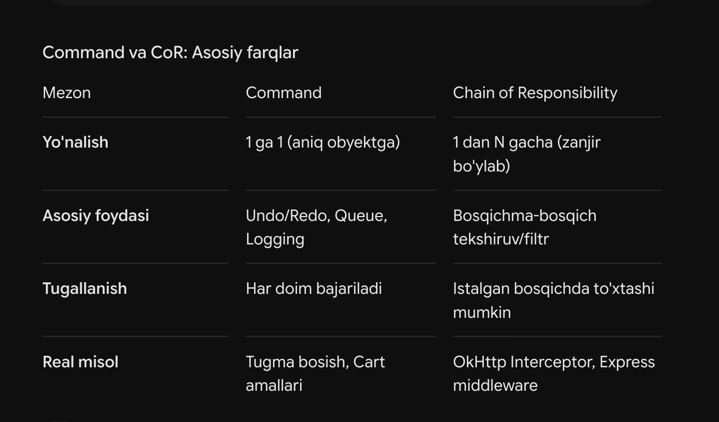

#### Chain of Responsibility (CoR) — so'rovni zanjir (handlerlar ketma-ketligi) bo'ylab uzatadi; har bir bo'g'in uni tekshirib, yo o'zi qayta ishlaydi/to'xtatadi, yo keyingisiga o'tkazadi ("kim hal qiladi?").

#### Chain of Responsibility (CoR) qanday ishlaydi?

Yuqoridagi diagrammada: so'rov (**Request**) birinchi Handler ga keladi. Agar shart bajarilsa (yashil belgi), keyingi Handler ga o'tadi. Agar xatolik bo'lsa yoki shu yerning o'zida javob qaytarish kerak bo'lsa (qizil belgi), zanjir to'xtaydi.

**Android** / **Backend**'dagi eng mashhur real misollar:

**OkHttp Interceptor**: Har bir HTTP so'rov zanjirdan o'tadi: AuthInterceptor (token qo'shadi) → LoggingInterceptor (log yozadi) → CacheInterceptor (keshni tekshiradi) → Server.

**Android Touch Events**: Ekranga barmoq tekkanda hodisa Activity → ViewGroup → Button zanjiri bo'ylab o'tadi; qaysi biri ushlab olsa, zanjir to'xtaydi.

