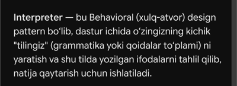

#### Oddiy qilib aytganda: agar loyihangizda foydalanuvchi yoki admin kiritadigan murakkab shartlar, formulalar yoki qoidalarni dasturiy ravishda hisoblab chiqish kerak bo‘lsa, Interpreter pattern ishlatiladi.

##### Interpreter — bu qoida yoki shartlarni if-else bilan qotirib qo‘ymasdan, ularни bir-biriga ulab yig‘iladigan LEGO obyektlariga aylantirishdir. Har bir shart — bitta obyekt (Expression). Ularni AND, OR, NOT orqali daraxt (tree) qilib bog‘laysiz va eng tepadan interpret(data) ni chaqirasiz — qolganini daraxtning o‘zi pastga qarab hisoblab chiqadi.