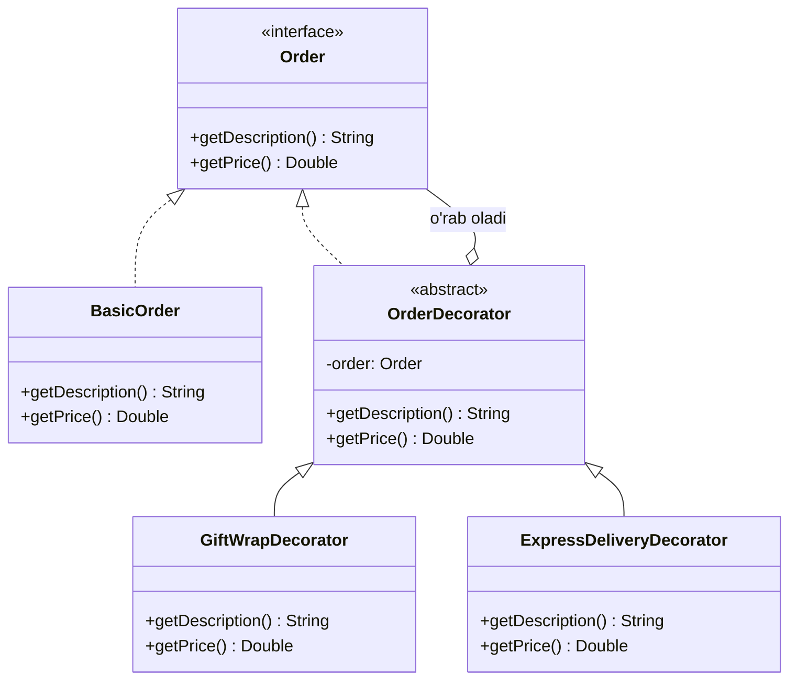
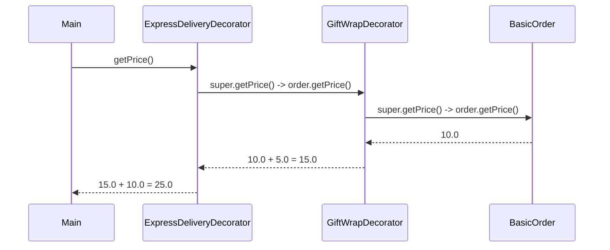
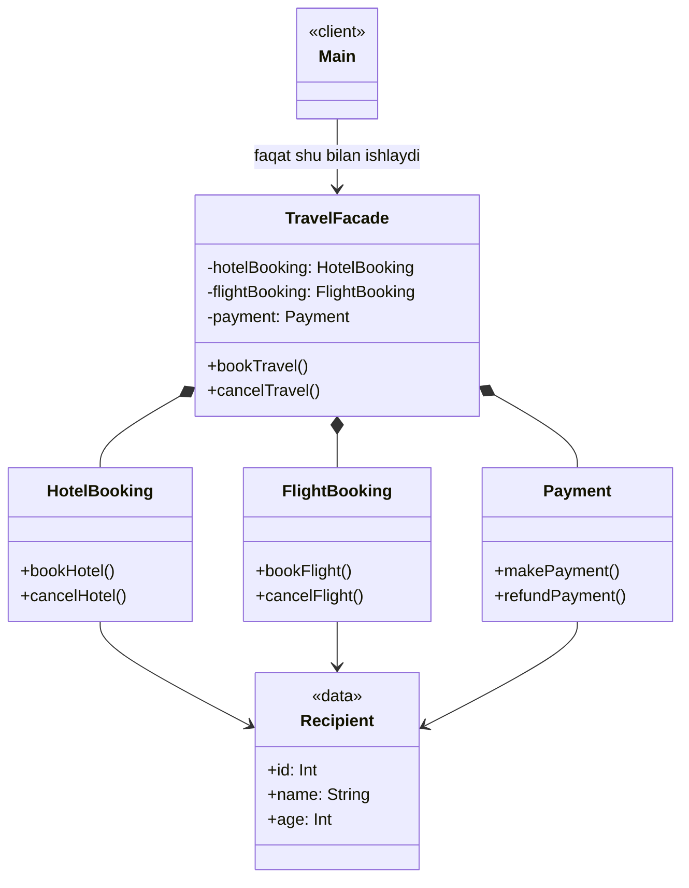
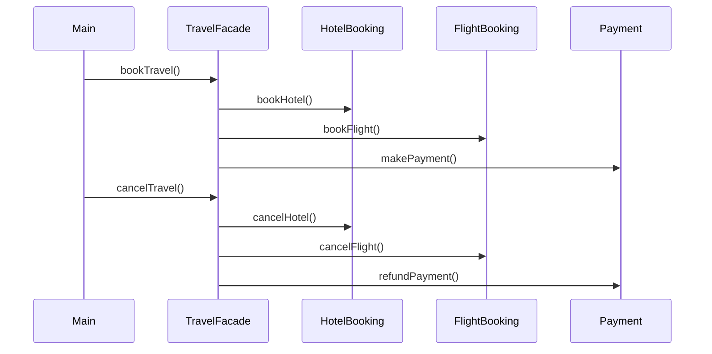

# Decorator va Facade patternlari (Kotlin)

Bu hujjat loyihadagi ikkita **structural** (tuzilmaviy) patternni tushuntiradi:

| Pattern       | Vazifa (Task)                           | Papka                                                        |
|:--------------|:----------------------------------------|:-------------------------------------------------------------|
| **Decorator** | Internet-do'kon buyurtmasiga xizmat qo'shish | [`src/structural/decorator`](decorator)                      |
| **Facade**    | Sayohatni bron qilish (mehmonxona, reys, to'lov) | [`src/structural/facade/travel_example`](facade/travel_example) |

Har bir bo'limda: muammo, yechim g'oyasi, fayllar va ularning roli, diagramma, kod qanday ishlashi,
dastur natijasi (haqiqatda ishga tushirib olingan) va eslatmalar bor.

---

## 1. Decorator pattern

### 1.1. Topshiriq

> Internet-do'konda oddiy buyurtmaga qo'shimcha xizmatlarni qo'shish imkonini beruvchi dastur yarating.
> Masalan, sovg'a sifatida qadoqlash yoki tezkor yetkazib berish.
>
> - `Order` nomli interfeys yarating. Unda `getDescription()` va `getPrice()` metodlari bo'lsin.
> - `BasicOrder` klassini yarating. U oddiy buyurtmani ifodalaydi.
> - `OrderDecorator` nomli bazaviy dekorator klassini yarating.
> - Ikkita dekorator yarating:
>   - `GiftWrapDecorator`: buyurtmaga sovg'a qadoqlash xizmatini qo'shadi.
>   - `ExpressDeliveryDecorator`: buyurtmaga tezkor yetkazib berish xizmatini qo'shadi.

### 1.2. Muammo: nega oddiy meros (inheritance) yetmaydi?

Xizmatlarni meros orqali qo'shsak, har bir kombinatsiya uchun alohida klass kerak bo'ladi:

```
BasicOrder
GiftWrapOrder
ExpressOrder
GiftWrapExpressOrder
GiftWrapExpressInsuranceOrder   <- yangi xizmat qo'shilsa, klasslar soni ko'payib ketadi
...
```

`N` ta xizmat bo'lsa, kombinatsiyalar soni `2^N` gacha yetadi. Bundan tashqari, meros **kompilyatsiya
vaqtida** belgilanadi: dastur ishlab turganda buyurtmaga xizmat qo'shib bo'lmaydi.

### 1.3. Yechim g'oyasi

**Decorator** obyektni **o'rab oladi** (wrap) va unga yangi xatti-harakat qo'shadi. Bunda asl klass
o'zgarmaydi.

Asosiy qoida:

> Dekorator **o'zi ham `Order`**, va **ichida boshqa `Order`ni saqlaydi**.

Shuning uchun dekoratorlarni xohlagancha va xohlagan tartibda bir-biriga o'rash mumkin.
Mijoz kod esa (masalan `main`) qaysi biri bilan ishlayotganini bilmaydi, chunki hammasi `Order`.

Matryoshka misolini eslang: har bir qo'g'irchoq ichida boshqasi bor, tashqi ko'rinishi esa bir xil.

### 1.4. Fayllar va ularning roli

| Fayl                          | Pattern'dagi roli        | Vazifasi                                                       |
|:------------------------------|:-------------------------|:---------------------------------------------------------------|
| `Order.kt`                    | **Component** (interfeys) | Barcha buyurtmalar uchun umumiy shartnoma: `getDescription()`, `getPrice()` |
| `BasicOrder.kt`               | **Concrete Component**   | Oddiy buyurtma. Tavsif: `"Basic order description"`, narx: `10.0` |
| `OrderDecorator.kt`           | **Base Decorator**       | `abstract` klass. `Order`ni implement qiladi va ichida boshqa `Order`ni saqlaydi. Chaqiruvlarni shunchaki ichki obyektga uzatadi |
| `GiftWrapDecorator.kt`        | **Concrete Decorator**   | Tavsifga `", Gift Wrapped"` qo'shadi, narxga `+5.0` qo'shadi |
| `ExpressDeliveryDecorator.kt` | **Concrete Decorator**   | Tavsifga `", Express Delivery"` qo'shadi, narxga `+10.0` qo'shadi |
| `Main.kt`                     | **Client**               | Buyurtmani yaratadi va uni ketma-ket dekoratorlar bilan o'raydi |

### 1.5. Klass diagrammasi



E'tibor bering: `OrderDecorator` dan `Order` ga ikkita bog'lanish bor:

- **implements** (`<|..`): dekorator o'zi ham `Order`;
- **has-a** (`o--`): dekorator ichida boshqa `Order` saqlanadi.

Pattern'ning butun kuchi shu ikkita bog'lanishning birga ishlashida.

### 1.6. Kod tahlili

**`Order.kt`**: hamma narsa shu interfeys orqali ishlaydi.

```kotlin
interface Order {
    fun getDescription(): String
    fun getPrice(): Double
}
```

**`BasicOrder.kt`**: zanjirning eng ichki qismi, ya'ni boshqa hech narsani o'ramaydigan "yadro".

```kotlin
class BasicOrder : Order {
    override fun getDescription(): String = "Basic order description"
    override fun getPrice(): Double = 10.0
}
```

**`OrderDecorator.kt`**: bazaviy dekorator. Hech narsa qo'shmaydi, faqat ichki `order`ga uzatadi
(delegation). Uning vazifasi: konkret dekoratorlarni har safar bir xil "uzatish" kodini yozishdan
qutqarish. `abstract` bo'lgani uchun undan to'g'ridan-to'g'ri obyekt yaratib bo'lmaydi.

```kotlin
abstract class OrderDecorator(private val order: Order) : Order {
    override fun getDescription(): String = order.getDescription()
    override fun getPrice(): Double = order.getPrice()
}
```

**`GiftWrapDecorator.kt`** va **`ExpressDeliveryDecorator.kt`**: avval `super` orqali ichki
buyurtmaning natijasini oladi, keyin unga o'z qismini qo'shadi.

```kotlin
class GiftWrapDecorator(private val order: Order) : OrderDecorator(order) {
    override fun getDescription(): String = super.getDescription() + ", Gift Wrapped"
    override fun getPrice(): Double = super.getPrice() + 5.0
}

class ExpressDeliveryDecorator(private val order: Order) : OrderDecorator(order) {
    override fun getDescription(): String = super.getDescription() + ", Express Delivery"
    override fun getPrice(): Double = super.getPrice() + 10.0
}
```

> Yuqoridagi parchalar o'qish oson bo'lishi uchun qisqartirilgan (expression body). Asl fayllarda xuddi
> shu mantiq `{ return ... }` ko'rinishida yozilgan.

**`Main.kt`**: obyektlar bosqichma-bosqich o'raladi:

```kotlin
val basicOrder: Order = BasicOrder()
val giftWrappedOrder: Order = GiftWrapDecorator(basicOrder)
val expressDeliveryOrder: Order = ExpressDeliveryDecorator(giftWrappedOrder)
```

Uchala o'zgaruvchining turi ham `Order`. Mijoz kod uchun oddiy buyurtma bilan ikki marta
"bezatilgan" buyurtma o'rtasida farq yo'q.

### 1.7. Chaqiruv qanday ishlaydi (qadamma-qadam)

Xotirada obyektlar shunday joylashgan:

```
ExpressDeliveryDecorator
 └── order = GiftWrapDecorator
              └── order = BasicOrder
```

`expressDeliveryOrder.getPrice()` chaqirilganda:



1. `ExpressDeliveryDecorator.getPrice()` avval `super.getPrice()` ni chaqiradi.
2. `OrderDecorator.getPrice()` ichki `order` ga, ya'ni `GiftWrapDecorator` ga murojaat qiladi.
3. `GiftWrapDecorator` ham shunday qiladi va `BasicOrder` gacha yetib boradi.
4. `BasicOrder` `10.0` qaytaradi.
5. Natija orqaga qaytayotganda har bir qatlam o'z qismini qo'shadi: `10 + 5 = 15`, keyin `15 + 10 = 25`.

`getDescription()` ham xuddi shu yo'l bilan ishlaydi, faqat sonlar o'rniga satrlar qo'shiladi.

### 1.8. Dastur natijasi

`structural.decorator.MainKt` ishga tushirilganda (haqiqiy natija):

```
Basic Order: Basic order description, Price: 10.0
Gift Wrapped Order: Basic order description, Gift Wrapped, Price: 15.0
Express Delivery Order: Basic order description, Gift Wrapped, Express Delivery, Price: 25.0
```

### 1.9. Topshiriq talablari bo'yicha tekshiruv

| Talab                                                  | Holati | Qayerda                       |
|:-------------------------------------------------------|:------:|:------------------------------|
| `Order` interfeysi, `getDescription()` va `getPrice()` | ✅     | `Order.kt`                    |
| `BasicOrder`: oddiy buyurtma                           | ✅     | `BasicOrder.kt`               |
| `OrderDecorator`: bazaviy dekorator                    | ✅     | `OrderDecorator.kt`           |
| `GiftWrapDecorator`: sovg'a qadoqlash                  | ✅     | `GiftWrapDecorator.kt`        |
| `ExpressDeliveryDecorator`: tezkor yetkazib berish     | ✅     | `ExpressDeliveryDecorator.kt` |

### 1.10. Pattern'ning qulayliklari

- **Kombinatsiyalar erkin.** Faqat sovg'a, faqat tezkor yetkazish, ikkalasi birga, istalgan tartibda.
  Hammasi yangi klass yozmasdan amalga oshadi:

  ```kotlin
  ExpressDeliveryDecorator(BasicOrder())                    // faqat tezkor
  GiftWrapDecorator(ExpressDeliveryDecorator(BasicOrder())) // teskari tartibda
  GiftWrapDecorator(GiftWrapDecorator(BasicOrder()))        // ikki marta qadoqlash ham mumkin
  ```

- **Open/Closed Principle.** Yangi xizmat qo'shish uchun (masalan `InsuranceDecorator`) faqat bitta
  yangi klass yoziladi. `Order`, `BasicOrder` va boshqa dekoratorlar o'zgarmaydi.
- **Single Responsibility.** Har bir dekorator faqat bitta xizmat uchun javob beradi.
- **Runtime'da qo'shish.** Xizmatlar dastur ishlayotganda qo'shiladi, masalan foydalanuvchi checkbox
  belgilaganda.

### 1.11. Kamchiliklari

- Dekoratorlar ko'p bo'lsa, zanjirni debug qilish qiyinlashadi, chunki obyekt ichma-ich joylashgan.
- O'rash tartibi `getDescription()` natijasiga ta'sir qiladi (matn tartibi o'zgaradi).
- Zanjir o'rtasidagi bitta dekoratorni olib tashlash oson emas.

### 1.12. Kod bo'yicha kichik eslatmalar

Bular xato emas, kod to'g'ri ishlaydi. Faqat keyinchalik e'tibor berish mumkin bo'lgan joylar:

- `GiftWrapDecorator` va `ExpressDeliveryDecorator` konstruktorida `private val order` deb e'lon
  qilingan, lekin bu maydon klass ichida ishlatilmaydi (natija `super` orqali olinadi). Shuning uchun
  oddiy parametr `order: Order` (`val`siz) ham yetarli bo'lardi.
- `OrderDecorator.kt` da `abstract  class` so'zlari orasida ikkita probel bor (faqat formatlash masalasi).
- Narx uchun `Double` ishlatilgan. O'quv misoli uchun bu normal holat. Haqiqiy pul hisob-kitobida
  yaxlitlash xatolari bo'lmasligi uchun odatda `BigDecimal` ishlatiladi (loyihadagi
  `adapter/with_payment` misolidagi kabi).

---

## 2. Facade pattern

### 2.1. Vazifa

Sayohatni rasmiylashtirish uchun bir nechta alohida tizim bilan ishlash kerak:

- mehmonxonani bron qilish (`HotelBooking`);
- aviareysni bron qilish (`FlightBooking`);
- to'lov qilish (`Payment`).

Bekor qilishda esa uchalasini ham teskari amal bilan chaqirish kerak.

### 2.2. Muammo

Facade bo'lmasa, mijoz kod har bir tizimni o'zi yaratishi va to'g'ri tartibda chaqirishi kerak:

```kotlin
val hotel = HotelBooking(recipient)
val flight = FlightBooking(recipient)
val payment = Payment(recipient)

hotel.bookHotel()
flight.bookFlight()
payment.makePayment()
```

Bu kod sayohat bron qilinadigan har bir joyda takrorlanadi. Mijoz kod esa ichki tizimlarning
hammasini bilishga majbur bo'ladi. Ertaga yana bitta qadam qo'shilsa (masalan, sug'urta), hamma joyni
o'zgartirish kerak bo'ladi.

### 2.3. Yechim g'oyasi

**Facade** murakkab tizimlar to'plami oldiga **bitta oddiy interfeys** qo'yadi. Mijoz faqat
facade bilan gaplashadi, facade esa ichkarida kerakli tizimlarni to'g'ri tartibda chaqiradi.

Turmushdan misol: turagentlik. Siz "menga sayohat kerak" deysiz, agentlik esa mehmonxona, chipta va
to'lovni o'zi hal qiladi.

### 2.4. Fayllar va ularning roli

| Fayl                | Pattern'dagi roli | Vazifasi                                                           |
|:--------------------|:------------------|:-------------------------------------------------------------------|
| `Recipient.kt`      | Ma'lumot modeli   | `data class`: `id`, `name`, `age`. Sayohat kim uchun ekanini bildiradi |
| `HotelBooking.kt`   | **Subsystem**     | `bookHotel()`, `cancelHotel()`                                     |
| `FlightBooking.kt`  | **Subsystem**     | `bookFlight()`, `cancelFlight()`                                   |
| `Payment.kt`        | **Subsystem**     | `makePayment()`, `refundPayment()`                                 |
| `TravelFacade.kt`   | **Facade**        | Uchala tizimni yaratadi va ikkita oddiy metod beradi: `bookTravel()`, `cancelTravel()` |
| `Main.kt`           | **Client**        | Faqat `TravelFacade` bilan ishlaydi                                |

### 2.5. Klass diagrammasi



`*--` (composition) belgisi shuni bildiradi: tizim obyektlarini `TravelFacade` **o'zi yaratadi** va
ularga egalik qiladi.

### 2.6. Kod tahlili

**Subsystem klasslar** (`HotelBooking`, `FlightBooking`, `Payment`) bir-biridan mustaqil. Ular
facade haqida hech narsa bilmaydi. Har biri konstruktorda `Recipient` qabul qiladi va o'z ishini
bajaradi:

```kotlin
class HotelBooking(private val recipient: Recipient) {
    fun bookHotel() { println("Hotel booked for ${recipient.name}") }
    fun cancelHotel() { println("Hotel booking canceled for ${recipient.name}") }
}
```

**`TravelFacade.kt`**: pattern'ning markazi.

```kotlin
class TravelFacade(private val recipient: Recipient) {
    private val hotelBooking = HotelBooking(recipient)
    private val flightBooking = FlightBooking(recipient)
    private val payment = Payment(recipient)

    fun bookTravel() {
        hotelBooking.bookHotel()
        flightBooking.bookFlight()
        payment.makePayment()
    }

    fun cancelTravel() {
        hotelBooking.cancelHotel()
        flightBooking.cancelFlight()
        payment.refundPayment()
    }
}
```

- Subsystem obyektlari `private`, ya'ni tashqaridan facade orqali ko'rinmaydi.
- `bookTravel()` uchta chaqiruvni bitta amalga birlashtiradi va **tartibni** belgilaydi.
- `cancelTravel()` teskari amallarni (bekor qilish, pulni qaytarish) bajaradi.

**`Main.kt`**: mijoz kod ikki qatorga qisqardi:

```kotlin
val recipient = Recipient(1, "John Doe", 30)
val travelFacade = TravelFacade(recipient)

travelFacade.bookTravel()
travelFacade.cancelTravel()
```

`Main` na `HotelBooking`ni, na `FlightBooking`ni, na `Payment`ni import qiladi yoki biladi.

### 2.7. Chaqiruv qanday ishlaydi



### 2.8. Dastur natijasi

`structural.facade.travel_example.MainKt` ishga tushirilganda (haqiqiy natija):

```
Booking travel...
Hotel booked for John Doe
Flight booked for John Doe
Payment made for John Doe

Canceling travel...
Hotel booking canceled for John Doe
Flight booking canceled for John Doe
Payment refunded for John Doe
```

### 2.9. Pattern'ning qulayliklari

- **Soddalik.** Mijoz uchta tizim o'rniga bitta klass va ikkita metod bilan ishlaydi.
- **Loose coupling.** Mijoz ichki tizimlarga bog'lanmagan. Masalan `Payment` ichi o'zgarsa, `Main` ga
  ta'sir qilmaydi.
- **Tartib bir joyda.** "Avval mehmonxona, keyin reys, keyin to'lov" degan qoida faqat
  `TravelFacade` ichida yozilgan va har joyda takrorlanmaydi.
- **Kengaytirish oson.** Yangi qadam (masalan `InsuranceBooking`) qo'shilsa, faqat facade
  o'zgaradi, mijoz kod esa o'zgarmaydi.

### 2.10. Kamchiliklari

- Facade'ga juda ko'p mas'uliyat yuklansa, u **"God object"**ga aylanib qolishi mumkin.
- Facade faqat eng ko'p ishlatiladigan ssenariylarni beradi. Nozik sozlash kerak bo'lsa, baribir
  subsystem bilan to'g'ridan-to'g'ri ishlashga to'g'ri keladi. Facade buni taqiqlamaydi:
  `HotelBooking`, `FlightBooking` va `Payment` hamon `public` klasslar.

### 2.11. Kod bo'yicha kichik eslatmalar

Bular xato emas, kod to'g'ri ishlaydi. Keyinchalik o'ylab ko'rish mumkin bo'lgan joylar:

- Subsystem obyektlari facade **ichida yaratiladi**. Shu sababli test paytida ularni soxta (mock)
  obyekt bilan almashtirib bo'lmaydi. Agar kerak bo'lsa, ularni konstruktor orqali berish mumkin
  (dependency injection), standart qiymatlarni esa saqlab qolsa bo'ladi.
- `cancelTravel()` bron qilish bilan bir xil tartibda bekor qiladi. Real tizimlarda bekor qilish
  ko'pincha **teskari tartibda** bajariladi (avval pulni qaytarish, keyin reys, keyin mehmonxona),
  ayniqsa bir qadam xato bersa.
- `Recipient` dagi `id` va `age` maydonlari hozircha ishlatilmayapti. Faqat `name` chiqariladi.

---

## 3. Decorator va Facade: farqi nimada?

| Mezon                     | Decorator                                      | Facade                                            |
|:--------------------------|:-----------------------------------------------|:--------------------------------------------------|
| **Maqsad**                | Obyektga **yangi xatti-harakat qo'shish**      | Murakkab tizimni **soddalashtirish**              |
| **Nechta obyekt bilan ishlaydi** | Bitta obyektni o'raydi                  | Bir nechta turli obyektni birlashtiradi           |
| **Interfeys**             | Asl obyekt bilan **bir xil** (`Order`)         | **Yangi**, soddaroq interfeys (`bookTravel()`)    |
| **Ichma-ich qo'llash**    | Ha, zanjir qilib o'rash mumkin                 | Yo'q, odatda bitta qatlam                         |
| **Mijoz nimani biladi**   | Faqat `Order` interfeysini                     | Faqat `TravelFacade` ni                           |
| **Loyihadagi misol**      | Buyurtma + sovg'a qadoqlash + tezkor yetkazish | Mehmonxona + reys + to'lov = sayohat              |

Loyihadagi **Adapter** pattern bilan solishtirsak (`src/structural/adapter`):

- **Adapter**: bitta obyektning interfeysini **boshqa interfeysga moslaydi** (`EmailClient` dan
  `NotificationService` ga).
- **Decorator**: interfeys **o'zgarmaydi**, faqat imkoniyat qo'shiladi.
- **Facade**: bir nechta obyekt uchun **yangi, sodda** interfeys yaratadi.

---

## 4. Qanday ishga tushiriladi

### IntelliJ IDEA

Quyidagi fayllarni oching va `main` funksiyasi yonidagi yashil ▶ tugmasini bosing:

```
src/structural/decorator/Main.kt
src/structural/facade/travel_example/Main.kt
```

### Terminal orqali

Loyihada `application` plagini yo'q, shuning uchun avval kompilyatsiya qilinadi, keyin `java` bilan
ishga tushiriladi:

```bash
./gradlew compileKotlin

KOTLIN_STDLIB=$(find ~/.gradle/caches -name "kotlin-stdlib-2.4.10.jar" | head -1)

java -cp "build/classes/kotlin/main:$KOTLIN_STDLIB" structural.decorator.MainKt
java -cp "build/classes/kotlin/main:$KOTLIN_STDLIB" structural.facade.travel_example.MainKt
```

---

## 5. Qisqacha xulosa

- **Decorator**: "obyektni o'zgartirmasdan, uni o'rab, yangi imkoniyat qo'sh". Har bir dekorator
  ham `Order`, ham ichida `Order` saqlaydi. Shuning uchun ular zanjir bo'lib ulanadi va narx/tavsif
  har bir qatlamda yig'ilib boradi.
- **Facade**: "murakkab tizimlar oldiga bitta oddiy eshik qo'y". `TravelFacade` uchta tizimni
  yashiradi va mijozga ikkita tushunarli metod beradi: `bookTravel()` va `cancelTravel()`.
